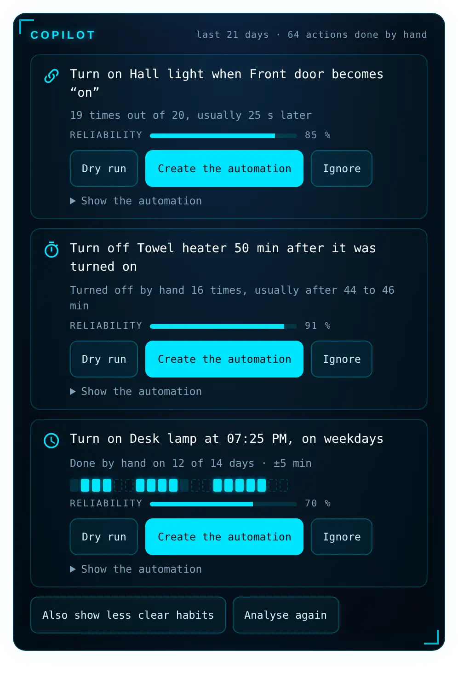
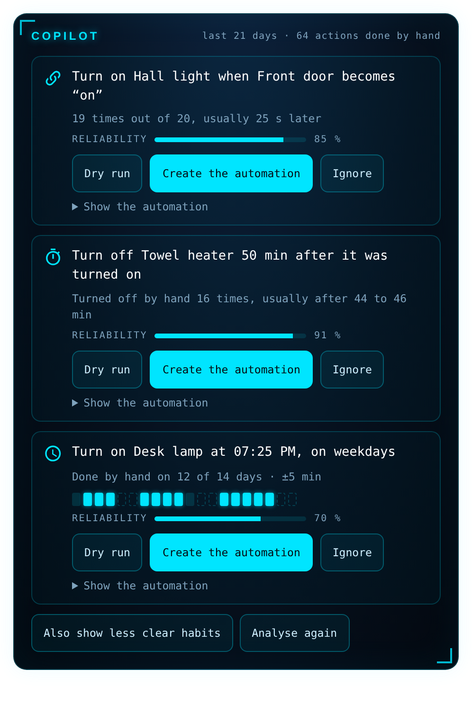
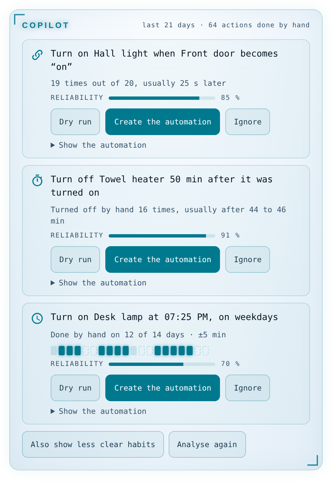

# SF Copilot

**Your home already knows what you want automated: you do it by hand every day.** SF Copilot reads Home Assistant's own history, finds the
things you keep doing yourself — the same light at the same time, the same switch after the same door, the same appliance turned off after
the same delay — and proposes the automation, with the evidence. Nothing real is created before a **dry run** has run for a week.

No cloud, no AI model, no data leaving the house: plain statistics in your browser, on the history Home Assistant already keeps.

<p align="center"></p>

```yaml
type: custom:sf-copilot-card
```

## Why

Home Assistant is getting easier every month (automatic dashboards, the Marketplace, "Triggered by", AI tasks), but writing an automation
still starts from a blank page: you have to know what to automate, and how. Most homes are full of small routines nobody ever turns into
automations, because nobody notices them any more.

SF Copilot starts from the other end: **from what the people in the house actually do**, and only that.

## What it finds

<p align="center"> &nbsp; </p>

*Invented house ("Alex"): the habits above are made-up data, not a real home.*

| Habit | Example | The automation it proposes |
|---|---|---|
| Same time of day | "Desk lamp on around 19:25, on 17 of the last 20 weekdays" | time trigger, weekdays / weekends / every day |
| Follows the sun | "Porch light on 15 min before sunset, every day for 4 weeks" (the clock time drifts, the sun offset does not) | sun trigger with offset |
| After an event | "Hall light on within a minute after the front door opens, 9 times out of 10" (optionally only at certain hours) | state trigger, time window |
| Turned off after a while | "Towel heater turned off by hand 17 times, usually 40 to 50 min after it came on" | state-for trigger |

Every proposal shows **why**: how many times, out of how many occasions, a strip of the days it happened, and a reliability score.

## What it ignores, on purpose

- What is **already automated**: changes made by automations, scripts (even one a person started) and service accounts (Node-RED,
  AppDaemon… run as system users) are not habits.
- Changes with **no context at all** (a wall switch, but just as often an integration syncing or a device coming back online) — unless you
  set `physical: true`.
- Things too regular to be a person (to the minute, every day): that is a timer somewhere.
- Things done together in the same second (a group, a scene): one action, not a habit.
- Entities that change all the time (screensavers, chargers polling): left out before the full history is read.

If the house is already well automated, the card says so, with the numbers, instead of inventing proposals.

## Dry run, then for real

The only way to a real automation (the default, and the recommended one):

1. **Proposal.** Nothing is written by looking at it.
2. **Dry run** (one press) creates an automation that only writes in the logbook what it would have done. Its start date is stored in the
   automation itself (a line `sf-copilot-trial-since: …` in its description), so it survives a Home Assistant restart.
3. **Observation** for `trial_days` days (default 7, 1 to 30). The card shows since when it has been on trial and when it last "would have
   acted". It is not offered for promotion while it is younger than that, turned off, or has never acted since it started.
4. **Create it for real** = your explicit validation, **two presses** within 4 s. It creates the real automation and removes the trial.
5. **Ignore** hides a proposal for you (saved in your Home Assistant user data, so it follows you on every device).

These rules are checked again in the code at the moment of the write (the trial is read back from Home Assistant, not from what the screen
showed), so a stale button, a trial deleted or edited by hand, or a page left open for days cannot skip them. An automation that already
exists under the same id (you edited it by hand) is **never overwritten**: the card says so and writes nothing.

`require_trial: false` brings back a direct "Create the automation" (still two presses). Not recommended: you give up the observation.

Created automations are ordinary ones: they are in Settings → Automations, editable like any other, named `SF Copilot · …`. The card only
ever creates or deletes **its own** automations (ids `sf_copilot_…`; a test fails if the code tries to write anything else).

## What it will never propose by default

Some actions are dangerous to automate from a statistical habit (a door you unlock every evening is not a reason to unlock it by itself).
The engine can still *see* the habit; the safety policy decides what may become an automation:

| Action | Default | Needs in `allow` |
|---|---|---|
| lights, switches, fans, input_booleans on / off | allowed | – |
| lock a door (`lock.lock`) | allowed | – |
| change a thermostat mode | allowed, **flagged "sensitive"** | – |
| close a cover (shutter, blind…) | allowed, **flagged "sensitive"** | – |
| **unlock** a door (`lock.unlock`) | **blocked** | `unlock` |
| **open** a cover (`cover.open_cover`), any kind | **blocked** | `open_cover` |
| open or close a cover whose `device_class` is `garage`, `gate` or `door` | **blocked** | `open_cover` (to open) **and** `access` |

Blocked proposals are not offered; the card tells you how many there are and lists them, so that nothing is hidden. Allowed risky actions
carry a visible ⚠ badge. The policy applies to the dry run too (nothing is "tried" that could not be created).

```yaml
type: custom:sf-copilot-card
allow: [unlock]        # only if you really want it; unknown entries are ignored
```

Limit: the card relies on Home Assistant's `device_class` to recognise a garage door. A garage door exposed as a plain cover with no
class looks like a shutter, and `open_cover` would then allow it. Add such entities to `exclude`.

## Permissions

- The card shows buttons only when Home Assistant says `user.is_admin === true`. If that is unknown or malformed, the card is read-only
  (fail closed), and it checks again when you press a button, since rights can change while a page is open.
- **That is a display rule, not a protection.** The real protection is Home Assistant's: `GET`, `POST` and `DELETE` on
  `/api/config/automation/config/…` are `@require_admin` in Home Assistant Core. `./test/server-permissions.sh` checks it against *your*
  server with a non-administrator token (the automated suite cannot: it uses a fake server). Run it once.
- Reading the logbook is available to every user, filtered by what they can see.

## What the detection can and cannot tell you

- It is **statistics on a history, not knowledge**: "done by hand 17 days out of 20" is a correlation. A habit can have a reason the
  history cannot show (guests, a holiday, a broken sensor). The reliability score is deliberately cautious on few occasions, and the dry run
  exists to check the proposal against real life before it can act.
- A change counts as a human action only when it was made through Home Assistant **by a user linked to a `person` entity**. If no person is
  linked to your account, your actions are classed as automatic and ignored: the card warns about it, and a "Detection: N human · N
  automatic · N physical" line (expandable) says how the changes were classified and why (automation, script, account with no person,
  no context, other). Nothing is reclassified as human to make a result appear.
- It reads your existing automations (administrators only: that is an admin API) and compares them with each proposal, on what is
  written in them, never by running them:
  **duplicate** (same entity, same action, same trigger: same time within 30 min, same sun event, same state trigger, same delay) → the
  proposal is hidden, counted and named, and a real creation is refused if one appears during the dry run (disabled ones do not count);
  **overlap** (acts on the same entity another way, or the opposite) → a ⚠ badge with the automation's name;
  **maybe** (a script, scene, template, label or blueprint that names the entity) → a ⚠ badge. Device and area targets are resolved with
  the registry.
  Limits: at most 400 automations are read; those written in YAML files (`packages/…`, `automations.yaml` entries Home Assistant cannot
  open in its editor) cannot be read, are counted as such, and are only reported as "maybe" when Home Assistant's own search says they
  touch the entity. Templates and scripts are never evaluated. **"Nothing found" is not "no duplicate".** Look at Settings → Automations
  before promoting.
- Changes with no context at all (wall switches, but also integrations syncing) are ignored unless `physical: true`.

## Options

```yaml
type: custom:sf-copilot-card
days: 21            # history analysed, 7 to 60
max: 8              # proposals shown
exclude:            # never proposed
  - light.night_light
physical: false     # true: changes with no context count as manual actions
trial_days: 7       # days a dry run must have run before it can become real, 1 to 30
require_trial: true # false: allow creating without a dry run (not recommended)
allow: []           # unlock, open_cover, access: actions blocked by default (see above)
theme: auto         # dark | light | auto
```

## Installation

**With HACS** (recommended): HACS → ⋮ → *Custom repositories* → add `https://github.com/khrom06/SF-Copilot`, type **Dashboard** → download
**SF Copilot** → reload the page. HACS adds the resource for you.

**By hand:** copy `dist/sf-copilot.js` to `/config/www/sf-copilot/`, add the resource `/local/sf-copilot/sf-copilot.js` (JavaScript
module) in Settings → Dashboards → Resources.

Then add the card:

```yaml
type: custom:sf-copilot-card
```

Requires Home Assistant with the recorder and logbook (on by default). French and English.

## Development

```bash
./test/run.sh                  # build check, reliability rules, engine tests in 5 time zones, card tests in headless Chrome
./test/server-permissions.sh   # live: Home Assistant refuses a non-administrator (needs your URL and a non-admin token)
```

`src/10-engine.js` (habit detection) and `src/20-automation.js` (automation builder) are pure functions with no DOM: they are tested in
node on synthetic histories where the right answer is known, including the cases that must give nothing.

## License

MIT. Part of the SF family ([SF Cards](https://github.com/khrom06/SF-Cards)).
